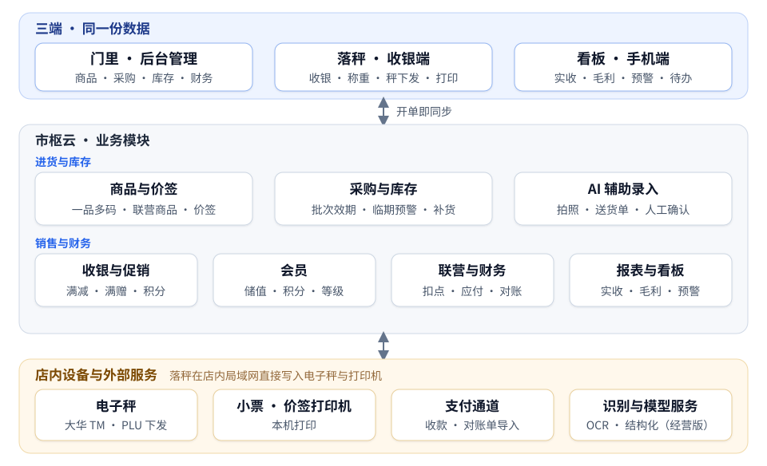

# 市枢 · 商超收银与进销存系统（开源部分）

**能收款的软件很多。能把联营、称重、日结和进销存算在同一本账上的，不多。**

门里管店 · 落秤收银 · 看板看数，三端同一份数据。

[**打开体验店**](http://trial.tyinuo.com/login)　·　[咨询源码与定制](#体验与咨询)　·　[看规则代码](#开源部分规则与协议)

---

## 店里真正难的，往往不是收款

| 常见痛点 | 市枢怎么不同 |
|----------|--------------|
| 联营月底对账靠表格和计算器，改过扣点就说不清该按哪一版 | **扣点在结账时定格**：合同有默认，商品可例外；已售行不因事后改点而变；按合作方汇总净销售、店抽成、应付 |
| 称重价改了，秤上还是旧价，柜台和价签各改各的 | **价格只改商品档**：改价后一键下传到店内秤，秤签扫进收银就是同一份价 |
| 日结只有一个总数，对不上不知道差在微信、支付宝还是现金抽屉 | **按支付方式对账**：现金、微信、支付宝、储值分开比对销售额；现金再对实点长短款 |
| 促销叠在一起，事后算不清这一步减了多少 | **固定顺序结算**：满减、券、满折满赠、整单优惠、积分依次生效，每一步金额可追溯 |
| 效期靠人盯，整包进、拆零卖对不上批次 | **批次进主流程**：临期预警，出库先出临期，整包与拆零同一套库存 |
| 录商品、录送货单占半天 | **拍照识别**：包装建档，送货单生成入库单，品名、数量、单价、效期一并填好 |
| 人不在店，只知道大概卖了多少 | **手机看板**：当天实收、毛利、库存预警和待办随时看 |
| 网一抖，扫码付不了就卡着 | **断网可收现金**：已缓存商品照常结账，联网后自动补传 |

市枢不是把这些能力挂在插件里，而是写进收银与进销存的主流程。

## 业务架构



三端进同一本账；落秤在店内局域网写入电子秤并打出小票。

## 和常见方案比

| | 擅长 | 常见缺口 |
|--|------|----------|
| 买机器送的收银软件 | 装上就能收 | 联营、效期、日结毛利、手机看板弱；秤价和档案容易脱节 |
| 买断式单机收银 | 一次付费、少依赖云 | 多人协作、跨端同步、手机看账、升级要自己扛 |
| 通用进销存 / 连锁 SaaS | 档案全、连锁成熟 | 联营扣点快照、称重下传、拆零效期常要另定制 |
| **市枢** | 联营、称重、效期、日结与收银同账 | — |

比的不是功能清单谁更长，而是月底对账、改价下秤、日结查差，是不是还要再开一张表。

---

## 体验与咨询

**想先看完整产品？** [打开体验店](http://trial.tyinuo.com/login)。账号扫下面名片，备注「体验」。

**想谈源码授权、二次开发或私有化？** 同一张名片，备注「源码 / 二开」，写上所在行业和门店数量。


---

## 开源部分：规则与协议

联营结算、促销叠算、日结对账、秤协议的计算规则在本仓库开源。纯 Java，无框架依赖，可直接读、直接跑。完整产品见体验店。

| 模块 | 内容 | 说明 |
|------|------|------|
| `saas-consign` | 联营扣点解析、按合作方结算店抽成与应付 | [联营规则](docs/consign.md) |
| `saas-promo` | 买赠、N 件 M 元、第二件折、第 N 件固定价、满减 | — |
| `saas-finance` | 应付到期与核销、毛利率、日结支付对账与现金长短款 | [应付与对账](docs/finance-payable.md) |
| `saas-device` | 条码秤 PLU 编帧、TCP 下发示例、称重条码解析 | [秤协议](docs/scale-plu.md) |
| `saas-core` | 金额约定与基础常量 | — |
| `saas-demo` + `web-demo` | 本地演示：浏览器里演算上面的规则 | 见下 |

### 在浏览器里试一试

环境：JDK 17+，Maven 3.9+。

```bash
cd java
mvn -q package -DskipTests
java -cp "saas-demo/target/classes;saas-core/target/classes;saas-consign/target/classes;saas-finance/target/classes;saas-device/target/classes" com.shishu.open.demo.DemoServer 8090 ../web-demo
```

Linux / macOS 把类路径里的 `;` 换成 `:`。打开 `http://127.0.0.1:8090/`，可试联营对账、日结对账、秤条码解析和 PLU 下发帧。

运行全部单元测试：`cd java && mvn test`

## 许可

开源部分采用 MIT 许可，见 [LICENSE](LICENSE)。
